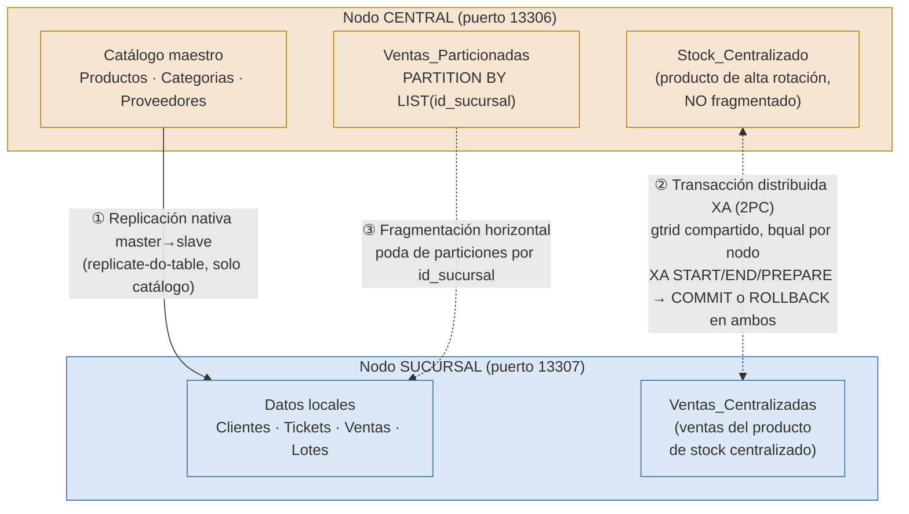

# Diagrama de arquitectura — demo de BD distribuidas

Topología implementada y probada en `db/distribuido/` (ver README ahí).

## Los tres mecanismos

| # | Mecanismo | Qué resuelve | Mecanismo técnico |
|---|---|---|---|
| ① | Replicación | El catálogo (productos, categorías, proveedores) debe ser el mismo en todas las sucursales, definido una sola vez en el central. | Replicación nativa MariaDB master→slave, filtrada con `replicate-do-table` para que solo el catálogo se replique (los datos operativos de cada sucursal quedan locales). |
| ② | Transacción distribuida (XA/2PC) | Un producto de alta rotación no se puede fragmentar por sucursal sin riesgo de sobreventa: su stock debe controlarse en un solo lugar (central), pero la venta ocurre en la sucursal. | `XA START/END/PREPARE` en ambos nodos con el mismo `gtrid` y `bqual` distinto por nodo; se confirma (`XA COMMIT`) solo si ambos prepararon, si no se hace `XA ROLLBACK` en los que sí prepararon. |
| ③ | Fragmentación horizontal | Las ventas de cada sucursal son volumen local que no tiene sentido mezclar físicamente; el central necesita poder consultarlas agregadas sin duplicar almacenamiento. | `PARTITION BY LIST (id_sucursal)` sobre una tabla desnormalizada (sin FK, porque MySQL/MariaDB no permite FK en tablas particionadas); poda de particiones confirmada con `EXPLAIN PARTITIONS`. |

## Por qué el stock centralizado (②) es distinto de las demás tablas fragmentadas

`Lotes`/`Tickets`/`Ventas` del esquema operativo (`db/schema.sql`) se
fragmentan por sucursal porque cada sucursal es dueña de su propio
inventario físico: no hay conflicto de concurrencia entre sucursales sobre
esas filas. `Stock_Centralizado` es la excepción deliberada del
entregable: representa un recurso que **sí** se comparte entre sucursales
(ej. un medicamento de importación con una sola partida nacional), y por
eso necesita coordinación transaccional explícita en vez de fragmentación.
