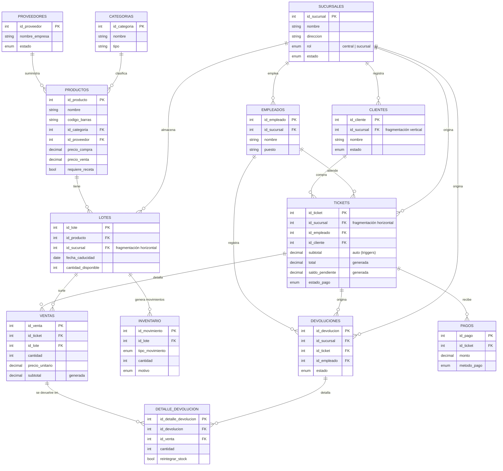

# Diagrama ER — Farmacia (con capa de sucursales)

Basado en `Farmacia_actualizado.md` + la capa de multi-sucursal de
`Plan_Proyecto.md` (sección 2), tal como está implementado en `db/schema.sql`.

## Leyenda de la capa distribuida

- **Catálogo maestro** (sin `id_sucursal`, replicado centro→sucursales):
  `Categorias`, `Proveedores`, `Productos`.
- **Fragmentación horizontal** (`id_sucursal` en la tabla, cada sucursal
  solo tiene sus propias filas): `Lotes`, `Tickets`, `Devoluciones`
  (y por herencia de FK: `Inventario`, `Ventas`, `Pagos`, `Detalle_Devolucion`).
- **Fragmentación vertical**: `Clientes` — el registro vive en la
  sucursal donde se dio de alta.
